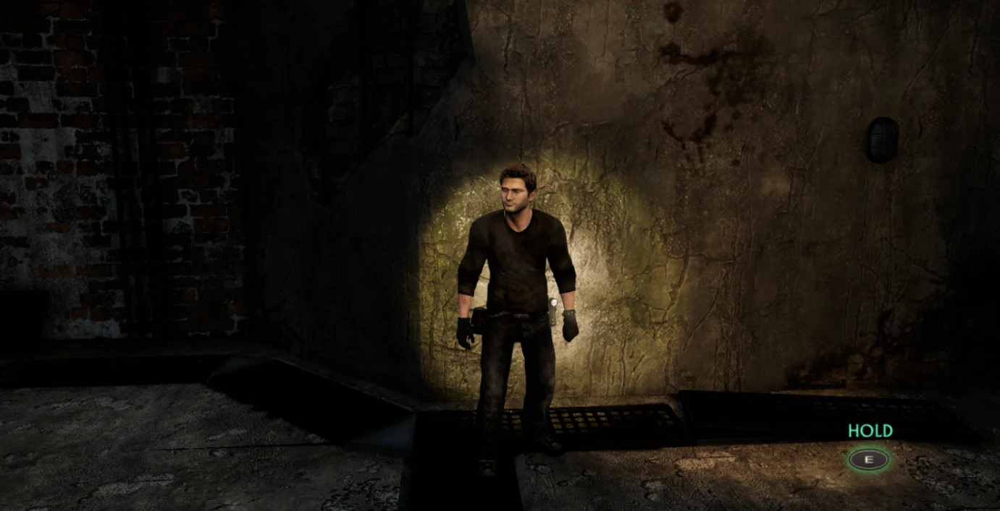
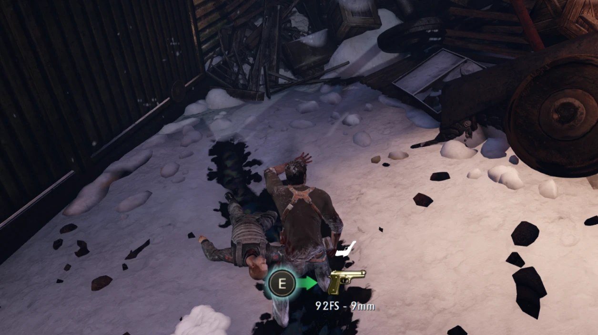
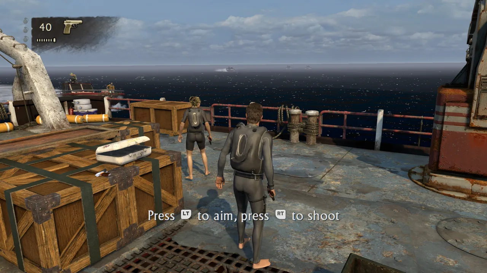
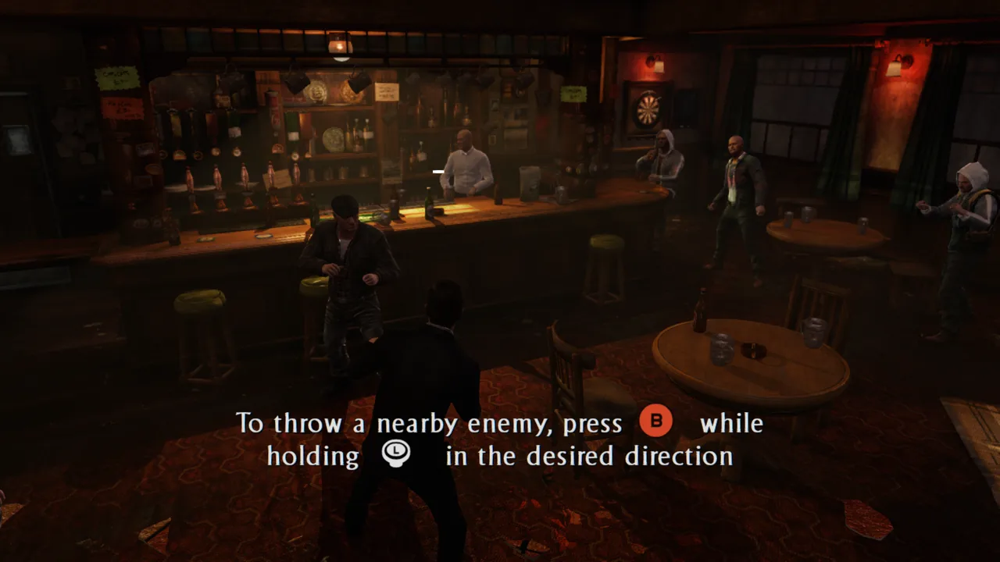
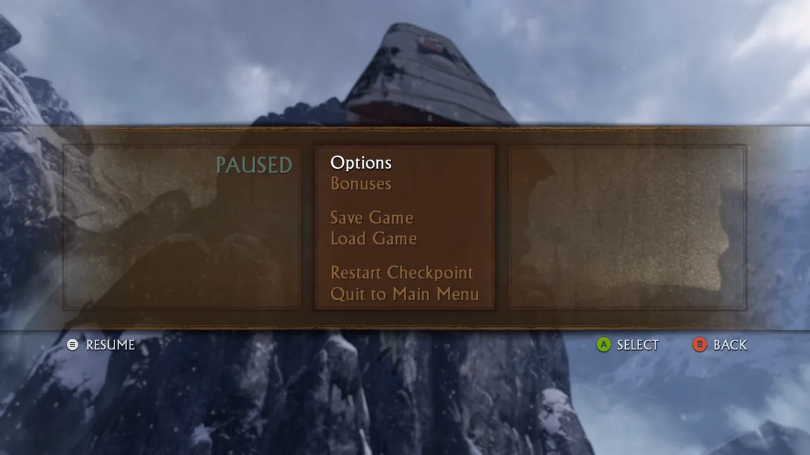
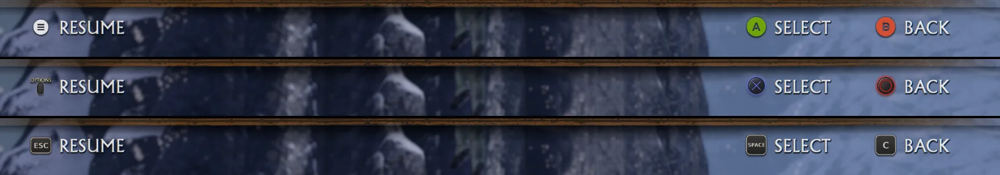

# Keyboard, mouse and Xbox button prompts

The games only know PlayStation buttons. This port redraws their button pictures as the keys and
mouse buttons bound in `input.ini` while the keyboard or mouse was used last, as Xbox buttons after
input from an Xbox (or any other non-PlayStation) controller, and gives the game's own pictures
back after PlayStation controller input. It also makes the bindings follow the keyboard layout.

| | |
|---|---|
|  |  |
| U3 title screen | U1 hint with the mouse buttons |
|  |  |
| U2 hint with the bound key | U2 hold prompt |
|  |  |
| U3 big prompt | U2 weapon pickup |

## What is covered

| Hash (XXH3 of mip 0) | Picture | Games | Seen in game |
|---|---|---|---|
| `97779d0906f16551` | icon sheet, 512x512 RGBA8 | U2 | yes |
| `ad5ada34fd34c76b` | icon sheet, 512x512 RGBA8 | U1 | yes |
| `8d03f2ff457f032d` | icon sheet colour, 512x512 RGBA8 (alpha 0) | U3 | yes |
| `ae0c06306763d424` | icon sheet mask, 512x512 RGBA8 (alpha in R, G, B) | U3 | yes |
| `5db884aa1bae54f9` | big round △, 256x256 BC1 | U1, U2, U3 | yes |
| `7af1abf688d8c824` | big round ○, 256x256 BC1 | U1, U2, U3 | image only |
| `9edd4f2f0f64f6e5` | big round □ (the flashing-border prompt of the last fight), 256x256 BC1 | U1, U2, U3 | yes |
| `2bf5d90eb864162f` | big round ✕, 256x256 BC1 | U1, U2 | game files only |
| `b88838d137123548`, `4999c8b20a45cd6d` | big L1, R1, 256x256 BC1 | U1, U2 | game files only |
| `539b560401a1ac83`, `e2c351d65c6a63f1` | big L2, R2, 256x256 BC1 | U1, U2 | game files only |
| `305c2c731ec227e6` | big round ✕, 256x256 BC1 (sRGB) | U3 | game files only |
| `6c3fc301ede4114a`, `bd74a617a879f120` | big L1, R1, 256x256 BC1 (sRGB) | U3 | game files only |
| `2e8ae3386e2a91dd`, `784278339a5a55bf` | big L2, R2, 256x256 BC1 (sRGB) | U3 | game files only |
| `25d954ce23a8f5e2` | △ tapping "puck", 512x512 BC1 | U1, U2 | yes |
| `c96e34fbb203279e` | △ hold puck, 512x512 BC1 | U1, U2 | yes |
| `07ff3d0e4090be85`, `4181f3ae6bd1efff` | △ tapping and hold pucks, 512x512 BC1 (sRGB) | U3 | game files only |
| `668cf3cc04ab6963`, `1b7e089f40b3bb21` | □ tapping and hold pucks, 512x512 BC1 (sRGB) | U3 | game files only |
| `94d741f6b51815ee` | ○ tapping puck, 512x512 BC1 (sRGB) | U3 | image only |
| `93b46ba81469882c` | ○ hold puck, 512x512 BC1 (sRGB) | U3 | image only |
| `705083db743dd2f9` | weapon d-pad, 256x256 BC1 | U2 | image only |
| `62ce1cf45bcd3fa6`, `7515a2f4f6a1022d`, `349208a673329cce`, `8d9e67192111aafb` | stick prompt, counter-clockwise, frames 1-4, 256x512 BC1 | U1, U2 | frames 2, 3 |
| `071de85cc9f9b927`, `a88cacd63b4d3120`, `1b6fd491c8e2509d`, `fd2317b11bf49f10` | its masks, frames 1-4, 256x512 BC4 | U1, U2 | no |
| `c40e867f01db15da`, `520ae52d155398d0`, `c79c5d399daa5371`, `de307a2c8adf213f` | stick prompt, clockwise, frames 1-4, 256x512 BC1 | U1 | no |
| `fa2b05a934e43c38`, `6517c5ecd522ad7f`, `c4c6e4617bc4ed1d`, `dd5680fbf43710c7` | its masks, frames 1-4, 256x512 BC4 | U1 | no |

The icon sheet has the same layout in all three games (`ps4_sheet` in `button_prompts.cpp`); it
holds the face buttons, shoulder buttons, sticks, d-pad variants, OPTIONS and the touchpad, which
menus and hints cut out. SHARE has no key and stays. Masks (BC4), glows, chevrons and weapon icons
are not buttons and are left alone.

The stick prompt of valves and wheels ("turn the left stick in circles") is a ring with arrows over a
stick cap that tips around in its socket: four frames (`Rotate-Analog-FRAME1..4`, counter-clockwise)
or their mirror images (`Rotate-Reverse-FRAME1..4`, clockwise), each a BC1 colour picture and a BC4
mask, 256x512, upside down and 1D-tiled. With the keyboard every frame becomes the same still picture:
the game's ring with its arrows, and below it, in place of the stick and socket, two keys side by side
for `ls_left` and `ls_right` (A and D; a mouse for a mouse button). `BuildStick` in `button_prompts.cpp`
takes the ring from the uploaded frame (the same in all four above the stick), redraws the bottom of
the ring's glow, which the stick's glow touches in frames 2 and 3, and fills in the keys in colour and
mask, for every mip level. `stick_keys` names the two actions. Xbox controllers keep the game's frames.
The colour frames are also in Uncharted 2's `hud.pak` with the same hashes; the clockwise set and all
of U1's full-size frames are in `particle.pak` or the texture stream (`texturedict1/chunk-1-tstrm.pak`).
Drake's Deception has its own encodings (BC1 sRGB, masks in BC1, frame 1 128x256) and is not covered.

"Game files only": hashed from the game's `hud.pak` (U1 keeps the same pictures in `particle.pak`), all
of `art/general/hud/buttons`, but not yet seen on screen. The shoulder prompts are drawn as keys in the
shape of the game's L1/R1 and L2/R2 pictures (`Bumper`, `LeftTrigger`, `RightTrigger`).

Not collected yet: the stick prompt in Drake's Deception, the right-stick variants
(`Rotate-AnalogRight`, `Rotate-ReverseRight`), and pictures only some screens use. Adding one is one table row (below).

## Switching

`runtime_pad.c` notes the last device used: a bound key, a mouse button, the wheel or mouse motion
of more than a few pixels means keyboard; a controller button, a trigger or a stick past half way
means controller. A DualShock or DualSense (or any pad SDL labels with ✕ ○ □ △) gets the game's own
pictures; every other controller gets Xbox buttons, since SDL names the buttons by position. It
calls `bbgpu_prompts_controller(device)` (0 keyboard, 1 PlayStation, 2 Xbox), logged as `Button
prompts: keyboard keys`, `Button prompts: PlayStation controller used, PlayStation buttons` or
`Button prompts: Xbox controller used, Xbox buttons`.

- `ReplaceButtonPrompts()` (`texture_cache.cpp`), after the game uploads a texture: when its size
  and format can be a known picture, its guest data is hashed; a match records the range and, in
  keyboard mode, uploads the keyboard version over it.
- `UpdateButtonPrompts()` (from `Rasterizer::OnSubmit`): after a switch, the recorded ranges are
  invalidated, so the game's data is uploaded again and replaced or not.

The keyboard pictures are built once per picture and mip count, on the GPU thread, from the current
`input.ini` (the first key of each action).

## Xbox buttons

The Xbox pictures are Kenney's [Input Prompts](https://kenney.nl/assets/input-prompts) (Xbox Series,
CC0, licence in `packaging/windows/licenses/kenney-input-prompts-LICENSE.txt`), placed on the same
pictures the keyboard version covers: A B X Y in the colours of the real buttons for ✕ ○ □ △, LB RB
LT RT, the stick presses, Menu for OPTIONS, View for the touchpad, the sticks and the d-pad with its
lit directions. The big prompts and the tapping and hold pucks get the A/B/X/Y picture, the U2
weapon d-pad the Xbox d-pad. The white pictures get a soft dark halo, as the PlayStation ones have
a glow.

| | |
|---|---|
|  |  |
| U1 hint with LT and RT | U3 hint with B and the left stick |
|  |  |
| U2 pause menu | the same bar after switching Xbox, PlayStation, keyboard in one run |

`tools/make_xbox_prompts.py <unzipped pack>` packs the 21 pictures (128 px each) into
`texture_cache/button_prompts_xbox.inc` (a zlib stream of the atlas, 15 KB; checked in, so the build
needs neither Python nor the pack). Adding one is a name in that script and an entry in `XGlyph`.

## Keyboard layouts

The launcher saves the character printed on the key the player pressed. `runtime_pad.c` used to
look every name up as a scancode, the key's position on a US keyboard, so on AZERTY a binding to Z
landed on the key labelled W.

- A one-character binding (letter, digit, punctuation) that differs from the action's default is
  `BIND_LAYOUT`: an SDL keycode, turned into a scancode with `SDL_GetScancodeFromKey` at each read,
  so a layout switch applies at once.
- Defaults stay positions (`BIND_KEY`): WASD is ZQSD on AZERTY, with no setup.
- The prompts label default letters with `SDL_GetKeyName` of the key at that position, so an AZERTY
  player sees ZQSD on the movement cap.
- The log lists each layout key once the keyboard is up:
  `Runtime: key.ls_up Z: the key labelled so in this keyboard layout (US position W)`.

Still in the launcher: keys whose Tk keysym is not a plain letter or digit (AZERTY's top row
`& é " '`, Cyrillic letters) are not captured, so they can't be bound.

## Switches

| Variable | Effect |
|---|---|
| `BB_BUTTON_PROMPTS=0` | keep the PlayStation buttons (also `off`, `playstation`) |
| `BB_BUTTON_PROMPTS=keyboard` / `xbox` | always show that style (default `auto`: the device used last); the launcher's Controls page has the same choice |
| `BB_BUTTON_PROMPTS_FILE=<path>` | the first word of that file (`ps`, `xbox`, `keyboard`) is the device used last, read twice a second: switching in runs without a controller (scripted runs ignore the real one) |
| `BB_ICON_COLLECT=1` | save every picture sampled by a pass that draws to the display to `user/button_icons/<hash>_<w>x<h>_<format>.dds` (uncompressed slots at most 4 times: a sheet can be empty at first) |
| `BB_TEXTURE_DUMP=1` | F10 saves every texture of the next frame and the pass list to `user/texture_dump/<time>/` |

The two tools are for development and off by default.

## Adding a picture

1. Run the game with `BB_ICON_COLLECT=1` and get the prompt on screen.
2. Look at the new files in `user/button_icons/`: `python tools/dds_view.py <out dir> <files>`
   writes PNGs (BC1, BC4, RGBA8; no packages needed). Check the colour channels too: U3's sheet
   has its alpha in a separate texture.
3. Add a row:
   - an icon sheet with the usual layout: `sheets[]` (hash, size, name, `ps4_sheet`, layer);
   - a big prompt: `pictures[]` (hash, size, shape, action, glow colour = a corner pixel of the
     picture, name). Shapes: `RoundButton`, `Puck`, `PressedPuck`, `HudDPad`.
4. The log shows `Button prompts: <name> drawn as keyboard keys (<n> mip levels)` when it is used.

Without a run: the level and HUD `.pak` files (`<game>data/build/main/pak*/ps4/`) hold the pictures
uncompressed. Each texture has a `RAW_DATA` record after its name (`art/.../name.tga/<id>.ndb`) with the
offset into the pak's GPU data, the size, the DXGI format (0x47/0x48 BC1, 0x50 BC4), the mip count and
the width and height. The GPU data starts at the file size minus the 32-bit value at 0x20 (U1); in the
U2 and U3 HUD paks at the sum of the values at 0x38 and 0x3c. The data is in the PS4's tiled layout;
the hash is XXH3-64 of mip 0 as stored (width / 4 x height / 4 x 8 bytes for BC1), so it needs no
untiling. To look at it, untile the 8x8-block micro tiles (block index bits x0 y0 x1 y1 x2 y2).

## Files

| File | What |
|---|---|
| `gpu/shadps4/video_core/texture_cache/button_prompts.{h,cpp}` | tables, drawing, BC1 encoder |
| `gpu/shadps4/video_core/texture_cache/texture_cache.{h,cpp}` | replacing after upload, switching |
| `gpu/shadps4/video_core/renderer_vulkan/vk_rasterizer.{h,cpp}` | switch check per submit |
| `gpu/shadps4/video_core/renderer_vulkan/vk_frame_capture.{h,cpp}` | collector and F10 dump |
| `gpu/bbgpu.h`, `gpu/shim/bbgpu.cpp`, `gpu/shim/window.cpp` | last device from the runtime |
| `src/runtime_pad.c` | last device, layout-aware bindings |
| `texture_cache/button_prompts_xbox.inc`, `tools/make_xbox_prompts.py` | the Xbox pictures and the script that packs them |
| `tools/dds_view.py` | collected pictures to PNG |
